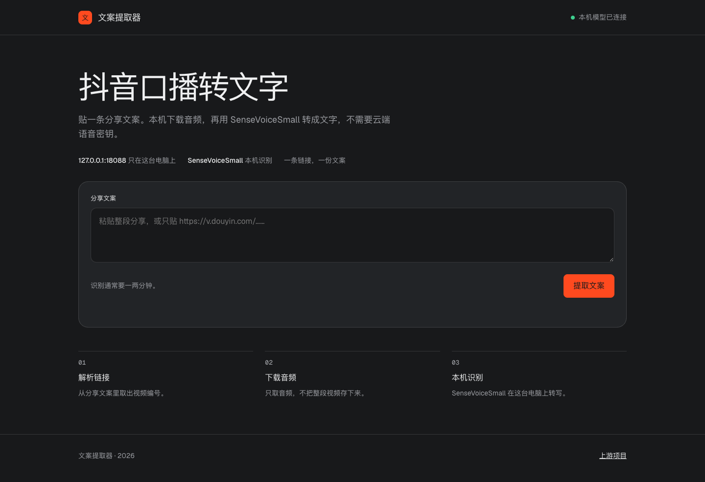

# 本机抖音口播转文字

给已经拿到分享链接、不想把音频送到云端语音接口的人。贴上链接，本机下载音频，再用 SenseVoiceSmall 转成文字。



页面只开在 `127.0.0.1:18088`。

## 页面做什么

输入框接受整段分享文案，也接受一条 `https://v.douyin.com/` 短链。点「提取文案」后，页面依次做三件事：

1. 从文字里取出视频编号。
2. 下载音频，不保存整段视频。
3. 用本机的 SenseVoiceSmall 转写。

结果区给出标题、视频编号和全文。可以复制，也可以下载 Markdown。一条视频通常要一两分钟。

## 安装

需要 Python 3.12。

```bash
git clone https://github.com/illli-studio/douyin-transcript.git
cd douyin-transcript
python3.12 -m venv .venv
source .venv/bin/activate
pip install -e '.[web]' 'mcp<2' 'funasr==1.2.7' 'modelscope==1.29.0' 'torch==2.8.0' 'torchaudio==2.8.0' 'numpy<2'
```

第一次启动会下载 SenseVoiceSmall。模型约 900 MB，放在 `models/`。

## 启动

```bash
HOST=127.0.0.1 PORT=18088 python web/app.py
```

打开 http://127.0.0.1:18088 。

## 留在本机的文件

| 文件 | 内容 |
| --- | --- |
| `models/` | SenseVoiceSmall，约 900 MB |
| `work/` | 本次下载的音频 |
| `~/.douyin-cookies.json` | 下载时使用的浏览器登录态 |

这三处都不进入 Git。

## 不适合的情况

- 想把音频发给硅基流动或百炼：这个页面不接云端语音密钥。
- 想从另一台电脑打开：服务只监听 `127.0.0.1`。
- 浏览器没有抖音登录态：音频下载会失败。

## 来源

代码改自 [yzfly/douyin-mcp-server](https://github.com/yzfly/douyin-mcp-server)。原项目使用 Apache License 2.0。
